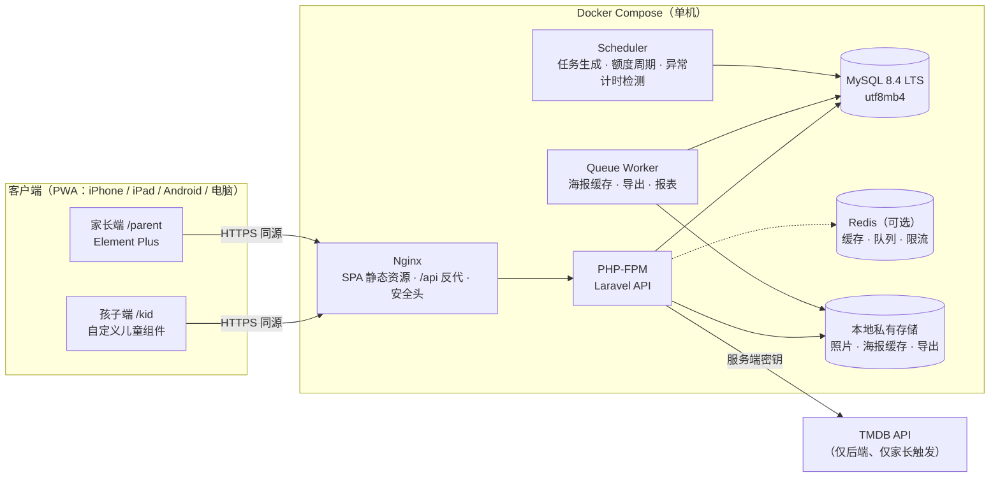
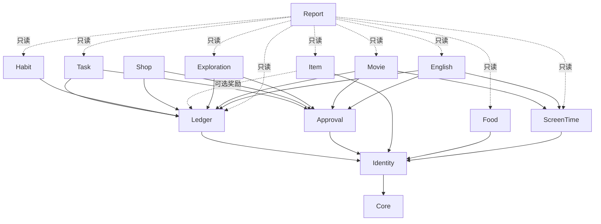

# 成长星球 — 系统架构（V1.0）

> 架构风格：模块化单体（Modular Monolith）｜前后端分离｜同源部署

## 1. 总体架构



**关键决策**

| 决策 | 选择 | 理由 |
|---|---|---|
| 架构 | 模块化单体 | 家庭规模；积分/审核/额度需要强事务一致性 |
| 前后端 | 分离开发，同源部署（Nginx 托管 SPA + 反代 `/api`） | 无需 CORS；Sanctum Cookie 会话 + CSRF |
| 认证 | Laravel Sanctum SPA 有状态会话 | 浏览器不持有长期 Bearer Token |
| 缓存/队列/会话 | 默认 `database` 驱动；设置 `REDIS_HOST` 后切换 Redis | Redis 可选（需求要求） |
| 时间 | 存 UTC；按家庭时区计算业务日期、周（周一 00:00 起） | 需求要求 |
| 第三方内容 | 外部 API 只由后端调用；外部数据入库前视为不可信、未审核 | 内容安全 |
| 测试数据库 | 真实 MySQL（容器） | 行锁、约束、并发行为需真实验证 |

## 2. 技术栈

| 层 | 技术 |
|---|---|
| 后端 | PHP 8.4（兼容 8.2+）、Laravel（安装时最新稳定版）、Sanctum |
| 数据库 | MySQL 8.4 LTS（8.0 已于 2026-04 停止支持） |
| 前端 | Vue 3、TypeScript（strict）、Vite、Pinia、Vue Router、vue-i18n（默认 zh-CN，预留其他语言） |
| 家长端 UI | Element Plus（按需引入） |
| 孩子端 UI | 自研组件：`PlanetTile`、`BigButton`、`KidCard`、`StarBurst`（尊重“减弱动态效果”与家长关闭设置） |
| 测试 | PHPUnit（Laravel 默认）、Vitest + Vue Test Utils、Playwright（后续阶段） |
| 部署 | Docker Compose；Nginx；Rocky Linux 9 / Debian 12 / Ubuntu 24.04 推荐 |

## 3. 业务模块划分

| 模块 | 职责 | 主要表（详见 database.md） | 阶段 |
|---|---|---|---|
| **Core** | 家庭作用域、时钟与时区、幂等、审计、附件、通知、系统设置 | `audit_logs`、`idempotency_keys`、`attachments`、`notifications`、`system_settings` | 1 |
| **Identity** | 家庭、成员、孩子档案、登录、设备授权、二次验证 | `families`、`users`、`family_members`、`child_profiles`、`trusted_devices` | 1 |
| **Ledger** | XP 与金币账本、金币预留、奖励策略与限额、冲正 | `xp_accounts`、`xp_ledger`、`coin_accounts`、`coin_ledger`、`coin_holds`、`reward_policies`、`reward_grants` | 2 |
| **Approval** | 统一审核中心（状态机、历史、防重复审批） | `approval_requests`、`approval_events` | 2 |
| **Task** | 任务定义、排期规则、每日实例、步骤、提交、自检、长期目标 | `tasks`、`task_steps`、`task_schedules`、`task_instances`、`task_instance_steps`、`task_submissions` | 2 |
| **Habit** | 习惯定义与打卡记录（弹性连续） | `habits`、`habit_records` | 2 |
| **Shop** | 奖励商品、兑换（预留 → 批准扣款 / 拒绝释放） | `rewards`、`reward_redemptions` | 2 |
| **Item** | 书包星球：物品、位置、状态、事件、检查清单 | `items`、`item_locations`、`item_events`、`item_checklists`、`item_checklist_lines` | 3 |
| **Exploration** | 勇敢探索：项目与阶段事件 | `exploration_projects`、`exploration_events` | 3 |
| **Food** | 食物探索日记（不与金币挂钩） | `foods`、`food_exploration_records` | 3 |
| **Movie** | 电影资料、年龄审核、白名单、申请、双观影位、进度、会话、评价、奖励事件；**电影系列**（TMDB collection / 家长管理、列表折叠、推荐聚合、孩子端防泄漏统计） | `movies`、`movie_age_reviews`、`movie_approvals`、`movie_requests`、`child_movie_library`、`movie_progress`、`movie_watch_sessions`、`movie_reviews`、`movie_reward_events`、`movie_collections`、`movie_collection_items`、`movie_collection_preferences` | 4（系列为 4.1 增强） |
| **English** | 家长维护的节目清单；孩子看完电视后自行登记，家长确认后发奖励 | `english_shows`、`english_watch_logs` | 5 |
| **ScreenTime** | 统一屏幕时间：策略、额度周期、观看条目（去重）、调整、异常 | `screen_time_policies`、`screen_time_entries`、`screen_time_adjustments` | 4 |
| **Report** | 日/周/长期报告、成长收藏馆、导出 | `child_daily_stats`、`exports`、`badges`、`child_badges` | 6 |

## 4. 模块依赖



**规则**

1. 依赖无环；模块之间只通过 `Contracts`（接口）和领域事件交互。
2. 只有 Ledger 写账本表；其他模块调用 `RewardService::grant(RewardIntent)`，由 Ledger 统一做限额、幂等和记账。
3. 只有 Approval 改变审核状态；业务模块注册 `ApprovalHandler`（批准/拒绝/退回/取消时的业务回调），回调与状态变更在**同一事务**中执行。
4. Food 模块**不依赖** Ledger（需求：食物尝试不与金币挂钩）；架构测试强制。
5. 只有 ScreenTime 写 `screen_time_entries`；Movie 在会话结束时、English 在家长确认登记时调用 `ScreenTimeRecorder::record(source)`，按 `(source_type, source_id)` 唯一去重。

## 5. 后端目录结构

```
backend/app/
├── Modules/
│   ├── Core/        Clock、FamilyScope、Idempotency、Audit、Settings、Http/ApiExceptionRenderer
│   ├── Identity/    Models、Http/Controllers/{Auth,Parent,Kid}、Requests、Resources、Policies、Actions
│   ├── Ledger/ … English/ …（各阶段新增）
└── Providers/
```

每个模块内：`Models/`、`Enums/`、`Actions/`（事务边界）、`Services/`、`Http/{Controllers,Requests,Resources}`、`Policies/`、`Contracts/`、`routes.php`。

## 6. 横切关注点

### 6.1 家庭与孩子数据隔离

- 所有业务表含 `family_id`；孩子业务数据另含 `child_id`（指向 `child_profiles.id`）。
- 查询统一从"当前家庭"出发（`CurrentFamily` 服务 + 模型作用域），跨家庭 ID 一律 404。
- 孩子会话只能访问 `child_id = 自己`；路由参数中的其他孩子 ID 返回 404（不泄露存在性）。

### 6.2 时间

- 应用时区 `UTC`，MySQL 会话时区 `+00:00`。
- `families.timezone` 默认 `Asia/Shanghai`；`Clock` 服务提供 `now()`、`today(family)`、`weekRange(family, date)`（周一 00:00 至周日 23:59:59.999，家庭时区）、`ageOn(birthDate, date)`。
- API 输出 ISO 8601 带偏移（如 `2026-10-11T19:30:00+08:00`），前端按 API 返回的家庭时区显示，不依赖设备时区。

### 6.3 幂等与防重复

三层：

1. **请求层**：变更接口携带 `Idempotency-Key`，`idempotency_keys` 表保存首次响应并重放。
2. **业务层**：奖励使用确定性业务键（如 `movie:first_start:{library_id}`），`reward_grants` 唯一约束；审核状态迁移用条件更新（`WHERE status='PENDING' AND lock_version=?`）。
3. **数据库层**：账本 `UNIQUE(idempotency_key)`、余额 `CHECK (balance >= 0)`、`CHECK (held <= balance)`。

### 6.4 内容安全（电影）

英语节目在电视上观看，成长星球只保存家长录入的节目名称和孩子的登记，不涉及外部视频内容。

- 白名单、默认拒绝：孩子端接口只查询"已批准 ∧ 适龄 ∧ 资料完整 ∧ 未被禁止"的内容视图；判定在后端 `ContentVisibility` 服务中进行，**不在前端过滤**。
- 年龄按出生日期在家庭时区当日动态计算；生日变化或孩子长大后可见集合自动变化。
- 不可见内容对孩子返回 404（与"不存在"无法区分）；搜索、建议、相关推荐只在可见集合内进行。
- 外部数据（TMDB 标题/海报/简介）视为不可信：入库前转义存纯文本、URL 白名单校验、图片下载到本地重新编码后由本站提供，孩子端从不直接加载外部图片。
- **电影系列不降低安全边界**：系列级收藏/屏蔽/偏好不能覆盖单部电影的年龄审核与白名单；孩子端系列 API / 搜索 / 详情 / 统计不得返回未批准成员的标题、数量、海报或简介；仅 1 部可见时按单片展示，禁止用「系列共 N 部」等字段暗示隐藏片存在。

### 6.5 审计

`audit_logs` 只追加：安全事件、配置变更、积分冲正、审核操作、内容审核、导出、删除。

### 6.6 通知

第一版为应用内通知（`notifications` 表 + 首页角标）：审核结果、额度快用完/到时、未履约兑换。Web Push 后续评估（iOS 需主屏安装 PWA）。

## 7. 第三方平台能力边界（不伪造集成）

| 能力 | 是否可实现 | 方案 |
|---|---|---|
| TMDB 电影资料 | ✅ 后端代理 | 家长搜索、选择后入库；海报本地缓存；页面显示 TMDB 署名；无密钥时可手动录入 |
| TMDB 系列（Collection） | ✅ 后端代理 | 导入/详情时读取 `belongs_to_collection` 与 Collection API，优先建立系列关系；**禁止**仅按标题相似自动归类；家长可创建/合并/拆分/改序；`structure_locked` 等字段保证 TMDB 更新不覆盖家长手动调整 |
| TMDB 分级数据 | ⚠️ 部分 | 读取 `release_dates` 中的分级（如 US/HK/TW）作为参考；**中国大陆无统一法定分级**；最终以家长审核为准；资料不足默认不开放 |
| 腾讯视频/爱奇艺/电视/手机 App 播放进度 | ❌ 无公开接口 | 手动记录：滑块、±5 分钟、计时器；标记为"手动记录" |
| 阻止第三方 App 播放 | ❌ | 不宣称；只管理本系统记录与提醒 |
| 电视上的英语节目观看记录 | ❌ 无法自动获取 | 孩子自行登记节目与时长，家长确认后才发奖励、计入屏幕时间；不对接 YouTube 或电视平台 |
| 设备级屏幕时间监控 | ❌ | 不实现；只统计本系统内记录的时长 |

## 8. 前端架构

```
frontend/src/
├── shared/      api 客户端（CSRF、幂等键、423 二次验证）、类型、时间工具、i18n
├── stores/      session 等 Pinia store
├── kid/         孩子端布局、星球首页、儿童组件
├── parent/      家长端布局（桌面侧栏 / 手机底部导航）、页面
├── router/      路由与守卫（体验层，权限以后端为准）
└── locales/     zh-CN.ts（预留 en-US）
```

- 孩子端以平板横竖屏为第一目标，触控目标 ≥ 56px；家长端手机布局使用卡片列表，不缩放桌面表格。
- 孩子设置：动画开关、声音开关（存服务端 `child_profiles.preferences`）。
- 电影系列折叠（阶段 4.1）：电影库 / 搜索 / 推荐 / 收藏架共用系列卡片组件；默认折叠，展开收起带动画；展开状态用前端 `sessionStorage` 按路由键记忆；数据以接口返回的可见成员为准，前端不做二次“猜系列”。

## 9. 部署拓扑

生产 Compose：`nginx`、`app`、`worker`、`scheduler`、`mysql`（可选 `redis`）。详见 `deployment.md`。

## 10. 架构决策记录（摘要）

| ADR | 决策 | 说明 |
|---|---|---|
| 001 | 模块化单体 | 不使用微服务 |
| 002 | Sanctum Cookie 会话 | 孩子端在家长授权的设备上用 PIN 登录 |
| 003 | UTC 存储 + 家庭时区周期 | 周一为一周起点 |
| 004 | XP 与金币分表记账 | XP 只增不减；金币有预留（hold） |
| 005 | 统一审核中心 + 业务回调 | 防重复审批 |
| 006 | 内容白名单在后端 SQL 层强制 | 不可见即 404 |
| 007 | 屏幕时间统一条目表 | 一个观看会话只计一次 |
| 008 | 出生日期加密存储 | 需求要求记录生日；使用 Laravel `encrypted` cast，年龄在应用层计算 |
| 009 | MySQL 8.4 LTS | 8.0 已停止支持 |
| 010 | 电影系列与单片解耦 | 系列只存分组与排序；进度/奖励/审核仍按单部 `movie_id`；孩子端系列视图由可见成员聚合，防泄漏；TMDB 同步尊重家长锁定字段 |
