# 成长星球 — 数据库设计（V1.0）

> MySQL 8.4 LTS｜InnoDB｜`utf8mb4` / `utf8mb4_0900_ai_ci`｜所有 `DATETIME` 存 UTC｜全部通过 Laravel Migration 创建

## 1. 通用约定

| 约定 | 说明 |
|---|---|
| 主键 | `id BIGINT UNSIGNED`；对外流水号/订单号另用 `ulid CHAR(26)` |
| 家庭隔离 | 业务表含 `family_id`（FK），孩子数据含 `child_id`（FK → `child_profiles.id`） |
| 时间 | `DATETIME(3)` UTC；业务日期 `DATE`（家庭时区）；周用 `week_start DATE`（家庭时区周一） |
| 枚举 | `VARCHAR(32)` + PHP backed enum |
| 数值 | 金币/XP 为整数；余额 `INT UNSIGNED` + CHECK |
| 只追加表 | 账本、审核事件、物品事件、审计、观看会话修正记录 — 模型钩子 + MySQL 触发器禁止 UPDATE/DELETE |
| 软删除 | 配置类表（任务、商品、物品、节目）用 `deleted_at`；只追加表禁止 |
| 乐观锁 | 有并发状态迁移的表含 `lock_version` |
| 敏感字段 | `child_profiles.birth_date` 使用 Laravel `encrypted` cast（数据库中为密文 TEXT） |

> 需求 §18 的建议表名大多被保留；为规范化做了以下调整：`tasks` 存定义、`task_schedules` 存排期规则（一个任务可有多条规则）；`item_locations` 是"地点字典"，物品当前位置是 `items.location_id`；`movie_progress` 是每个孩子每部电影一行的当前状态投影；`system_settings` 支持系统级与家庭级两种作用域；`movie_collections` 是电影系列（Franchise），与成长收藏馆 API `/kid/collection` 无关。

## 2. 实体关系总览

```mermaid
erDiagram
    families ||--o{ family_members : has
    users ||--o{ family_members : "joins"
    family_members ||--o| child_profiles : "child member"
    families ||--o{ trusted_devices : authorizes
    families ||--o{ system_settings : configures

    child_profiles ||--|| xp_accounts : owns
    child_profiles ||--|| coin_accounts : owns
    xp_accounts ||--o{ xp_ledger : records
    coin_accounts ||--o{ coin_ledger : records
    coin_accounts ||--o{ coin_holds : reserves
    reward_policies ||--o{ reward_grants : limits
    reward_grants ||--o| xp_ledger : posts
    reward_grants ||--o| coin_ledger : posts

    approval_requests ||--o{ approval_events : history

    tasks ||--o{ task_steps : has
    tasks ||--o{ task_schedules : "scheduled by"
    tasks ||--o{ task_instances : generates
    task_instances ||--o{ task_instance_steps : snapshot
    task_instances ||--o{ task_submissions : receives
    habits ||--o{ habit_records : logs

    rewards ||--o{ reward_redemptions : "redeemed (snapshot)"
    reward_redemptions ||--o| coin_holds : reserves

    item_locations ||--o{ items : "current location"
    items ||--o{ item_events : history
    item_checklists ||--o{ item_checklist_lines : contains

    exploration_projects ||--o{ exploration_events : stages
    foods ||--o{ food_exploration_records : records

    movies ||--o{ movie_age_reviews : "reviewed (history)"
    movies ||--o{ movie_approvals : "approved for child"
    movies ||--o{ movie_requests : requested
    movies ||--o{ child_movie_library : collected
    movie_collections ||--o{ movie_collection_items : contains
    movies ||--o| movie_collection_items : "optional franchise"
    movie_collections ||--o{ movie_collection_preferences : "family/child prefs"
    child_movie_library ||--|| movie_progress : state
    child_movie_library ||--o{ movie_watch_sessions : watched
    child_movie_library ||--o{ movie_reviews : reviewed
    child_movie_library ||--o{ movie_reward_events : rewards

    english_shows ||--o{ english_watch_logs : logged
    english_watch_logs ||--o| approval_requests : confirmed
    english_watch_logs ||--o{ reward_grants : rewards

    screen_time_policies ||--o{ screen_time_adjustments : adjusted
    movie_watch_sessions ||--o| screen_time_entries : counted
    english_watch_logs ||--o| screen_time_entries : counted
```



---

## 3. 身份与家庭（第一阶段实现）

### `families`
| 列 | 类型 | 说明 |
|---|---|---|
| id | PK | |
| name | VARCHAR(64) | |
| timezone | VARCHAR(64) | 默认 `Asia/Shanghai`，IANA 名称校验 |
| locale | VARCHAR(16) | 默认 `zh-CN` |
| week_starts_on | TINYINT | 默认 1（周一） |
| timestamps | | |

### `users`（登录身份）
| 列 | 类型 | 说明 |
|---|---|---|
| id | PK | |
| username | VARCHAR(32) NULL UNIQUE | 家长登录名 |
| email | VARCHAR(191) NULL UNIQUE | 家长可选 |
| password | VARCHAR(255) NULL | 家长 argon2id/bcrypt 哈希；孩子为空 |
| pin_hash | VARCHAR(255) NULL | 孩子 PIN 哈希 |
| failed_login_count | SMALLINT UNSIGNED | |
| locked_until | DATETIME(3) NULL | |
| last_login_at | DATETIME(3) NULL | |
| remember_token, timestamps | | |

> 家长与孩子都是 `users`；角色由 `family_members.role` 决定。孩子没有密码，只能经授权设备 + PIN 登录。

### `family_members`
| 列 | 类型 | 说明 |
|---|---|---|
| id | PK | |
| family_id | FK families | |
| user_id | FK users UNIQUE | 第一版一个用户只属于一个家庭（UNIQUE 可在未来放开为 `(family_id, user_id)`） |
| role | VARCHAR(16) | `parent` / `child` |
| display_name | VARCHAR(32) | 家长称呼（如"妈妈"）或孩子昵称 |
| status | VARCHAR(16) | `active` / `disabled` |
| timestamps | | |

索引 `(family_id, role)`。

### `child_profiles`
| 列 | 类型 | 说明 |
|---|---|---|
| id | PK | 业务表中的 `child_id` 指向这里 |
| family_id | FK families | 冗余，便于隔离查询 |
| member_id | FK family_members UNIQUE | |
| nickname | VARCHAR(32) | |
| avatar | VARCHAR(32) | 内置头像代码（不上传孩子照片） |
| birth_date | TEXT | **加密**存储；仅家长可设置/修改 |
| grade | TINYINT UNSIGNED | 1–6 |
| theme_color | CHAR(7) | `#RRGGBB` |
| status | VARCHAR(16) | `active` / `paused` / `archived` |
| preferences | JSON | `{"animations":true,"sounds":true}` |
| timestamps | | |

当前年龄不存储，由 `Clock::ageOn(birth_date, today(family))` 动态计算。

### `trusted_devices`
| 列 | 说明 |
|---|---|
| id, family_id | |
| name | 如"客厅 iPad" |
| token_hash | CHAR(64) UNIQUE，SHA-256（明文仅存在于 HttpOnly Cookie） |
| authorized_by | FK users |
| last_used_at, revoked_at, timestamps | |

### `system_settings`
| 列 | 说明 |
|---|---|
| id | |
| family_id | NULL = 系统级默认 |
| key | VARCHAR(96)，如 `ledger.daily_coin_cap`、`movie.weekly_minutes`、`english.daily_minutes`、`auth.sudo_ttl_minutes` |
| value | JSON |
| updated_by | |
| timestamps | |

UNIQUE(`family_id`, `key`)（应用层处理 NULL）。键名、类型、默认值由代码中的 `SettingsRegistry` 定义并校验。

### `audit_logs`（只追加）
`id`、`family_id NULL`、`actor_user_id NULL`、`actor_role`、`action VARCHAR(64)`、`subject_type`、`subject_id`、`changes JSON`（敏感字段脱敏）、`ip VARCHAR(45)`、`user_agent VARCHAR(255)`、`request_id`、`created_at`。

### `idempotency_keys`
`id`、`user_id`、`key VARCHAR(64)`、`method_path`、`request_hash CHAR(64)`、`status`（`processing`/`completed`）、`response_code`、`response_body JSON`、`created_at`。UNIQUE(`user_id`, `key`)。

### Laravel 内置表
`sessions`、`cache`、`cache_locks`、`jobs`、`job_batches`、`failed_jobs`、`personal_access_tokens`（Sanctum，SPA 模式不使用但保留迁移）。

### `notifications`（第一阶段建表，第二阶段起使用）
`id`、`family_id`、`recipient_user_id`、`type`、`title`、`body`、`data JSON`、`read_at`、`created_at`。

### `attachments`（第三阶段起使用）
`id`、`family_id`、`owner_type`、`owner_id`、`disk`、`path`、`thumb_path`、`mime`、`size_bytes`、`sha256`、`uploaded_by`、`created_at`、`deleted_at`。上传图片重新编码并去除 EXIF。

---

## 4. 账本与奖励（第二阶段）

### `xp_accounts` / `coin_accounts`
| 列 | 说明 |
|---|---|
| id, family_id | |
| child_id | UNIQUE |
| balance | INT UNSIGNED，`CHECK (balance >= 0)` |
| held（仅金币） | INT UNSIGNED，`CHECK (held <= balance)`；兑换预留 |
| lifetime_earned | |
| lock_version, updated_at | |

可用金币 = `balance − held`。

### `xp_ledger` / `coin_ledger`（只追加）
| 列 | 说明 |
|---|---|
| id, ulid（交易 ID） | |
| family_id, account_id, child_id | |
| amount | 有符号，≠ 0；XP 表只允许 `> 0`，冲正除外（见 points-rules.md §1） |
| balance_before / balance_after | |
| entry_type | `reward`、`redemption`、`refund`、`reversal`、`parent_bonus`… |
| source_module | `task`、`habit`、`shop`、`movie`、`english`、`exploration`、`parent` |
| source_type / source_id | 来源业务对象 |
| idempotency_key | UNIQUE |
| reversal_of_id | UNIQUE NULL（同一笔只能冲正一次） |
| approved_by | 审核人 NULL |
| operator_id | 操作人 NULL（系统） |
| note | |
| business_date | DATE（家庭时区） |
| created_at | |

### `coin_holds`
`id`、`family_id`、`account_id`、`amount`、`source_type`、`source_id`、`status`（`active`/`captured`/`released`）、`idempotency_key UNIQUE`、`captured_ledger_id`、`timestamps`。

### `reward_policies`
`id`、`family_id`、`code`（如 `task.complete`、`movie.first_start`、`movie.completion`、`movie.cross_movie`、`english.active_choice`）、`xp_amount`、`coin_amount`、`requires_approval`、`max_per_event`、`max_per_day`、`max_per_week`、`max_per_subject`（同一业务对象最多次数）、`is_active`、timestamps。所有金额与限额可配置，代码中只有默认种子值。

### `reward_grants`
| 列 | 说明 |
|---|---|
| id, family_id, child_id | |
| policy_code | |
| grant_key | VARCHAR(128) **UNIQUE**，确定性业务键（如 `movie:completion:{library_id}`） |
| source_module, source_type, source_id | |
| occurred_at | 业务事件实际发生时间（用于"按事件顺序"判断） |
| xp_amount, coin_amount | 计划发放 |
| status | `pending_approval` / `granted` / `rejected` / `capped` / `reversed` |
| approval_request_id | NULL |
| xp_ledger_id, coin_ledger_id | |
| cap_detail | JSON：被哪条限额截断 |
| timestamps | |

> 所有模块发奖都先写 `reward_grants`；`grant_key` 唯一保证"不同模块不能通过重复提交同一事件获得多份奖励"。

## 5. 统一审核（第二阶段）

### `approval_requests`
| 列 | 说明 |
|---|---|
| id, family_id, child_id | |
| type | `task_completion`、`reward_grant`、`redemption`、`movie_add`、`movie_completion`、`movie_cross`、`english_log`、`exploration` |
| subject_type / subject_id | 业务对象 |
| status | `PENDING` / `APPROVED` / `REJECTED` / `RETURNED` / `CANCELLED` |
| requested_by, requested_at | |
| decided_by, decided_at, decision_note | |
| active_key | VARCHAR(128) NULL **UNIQUE**：PENDING 时为 `type:subject_type:subject_id`，终态时置 NULL — 保证同一事项同一时间只有一个待审 |
| lock_version, timestamps | |

### `approval_events`（只追加）
`id`、`approval_request_id`、`from_status`、`to_status`、`actor_id`、`note`、`created_at`。

## 6. 任务与习惯（第二阶段）

### `tasks`（任务定义）
`id`、`family_id`、`child_id NULL`（NULL=全部孩子）、`category`、`title`、`icon`、`description`、`kind`（`standard`/`stepped`/`long_term`）、`start_date`、`end_date NULL`、`estimated_minutes NULL`、`xp_reward`、`coin_reward`、`requires_approval`、`requires_self_check`、`with_parent`（与家长协作完成）、`is_active`、`version`、`created_by`、timestamps、deleted_at。

### `task_steps`
`id`、`task_id`、`title`、`is_required`、`is_self_check`（如"检查有没有漏题"）、`sort`。

### `task_schedules`
`id`、`task_id`、`frequency`（`daily`/`weekly`/`dates`/`once`）、`weekdays JSON`、`dates JSON`、`due_time TIME NULL`。

### `task_instances`
`id`、`family_id`、`child_id`、`task_id`、`task_version`、`task_date`、`generation_key UNIQUE`（`task:{id}:child:{id}:{date}`）、`snapshot JSON`（标题、图标、步骤、奖励、审核设置）、`status`（`pending`/`in_progress`/`submitted`/`returned`/`completed`/`cancelled`）、`ready_at`（"我准备开始了"）、`first_step_at`、`submitted_at`、`completed_at`、`self_checked BOOLEAN`、`lock_version`、timestamps。

> 开始较慢不影响奖励：奖励计算不使用 `ready_at` 等时间字段，它们只用于报告中的"自主开始"观察。

### `task_instance_steps`、`task_submissions`
步骤快照与每次提交（`attempt_no`、`note`、`returned_reason`）。

### `habits` / `habit_records`
`habits`：`id`、`family_id`、`child_id`、`title`、`icon`、`frequency`、`target_per_period`、`xp_reward`、`coin_reward`、`is_active`。
`habit_records`：`id`、`habit_id`、`child_id`、`record_date`、`recorded_by`、`note`；UNIQUE(`habit_id`, `record_date`)。连续天数在查询时计算，弹性规则（如 7 天内 5 天）不清零永久 XP。

## 7. 奖励商城（第二阶段）

### `rewards`
`id`、`family_id`、`name`、`image_attachment_id`、`description`、`kind`（`physical`/`family_activity`/`virtual_decoration`）、`coin_price`、`stock NULL`、`requires_approval`、`status`（`draft`/`on_shelf`/`off_shelf`）、`version`、timestamps、deleted_at。

### `reward_redemptions`
`id`、`ulid`、`family_id`、`child_id`、`reward_id`、`reward_snapshot JSON`、`coin_price`、`status`（`requested`/`approved`/`rejected`/`cancelled`/`fulfilled`）、`coin_hold_id`、`coin_ledger_id`、`approval_request_id`、`idempotency_key UNIQUE`、timestamps。

流程：申请 → `coin_holds(active)` → 批准：扣款 `coin_ledger` + hold `captured` / 拒绝：hold `released`。

## 8. 书包星球（第三阶段）

### `item_locations`（地点字典）
`id`、`family_id`、`kind`（`home`/`bag`/`school`/`desk`/`other`）、`name`、`is_system`、`sort`。

### `items`
`id`、`family_id`、`child_id`、`name`、`category`、`image_attachment_id`、`color`、`note`、`location_id`（当前位置）、`location_confirmed_at`、`status`（`normal`/`temporarily_missing`/`lost`/`found`/`damaged`）、`carry_daily BOOLEAN`、`lock_version`、timestamps、deleted_at。

> **位置（`location_id`）与状态（`status`）分开**：一个水杯可以"在学校 + 正常"，也可以"位置未知（保留最后已知位置）+ 暂时找不到"。

### `item_events`（只追加）
`id`、`family_id`、`item_id`、`event_type`（`moved`/`checked`/`reported_missing`/`found`/`marked_lost`/`damaged`/`correction`）、`from_location_id`、`to_location_id`、`from_status`、`to_status`、`checklist_line_id`、`actor_id`、`occurred_at`、`note`、`created_at`。

### `item_checklists` / `item_checklist_lines`
`item_checklists`：`child_id`、`kind`（`before_school`/`after_school`）、`target_date`、`status`；UNIQUE(`child_id`, `kind`, `target_date`)。
`item_checklist_lines`：`item_id`、`result`（`pending`/`present`/`not_found`/`left_at_school`）、`actor_id`、`checked_at`。

## 9. 勇敢探索与食物日记（第三阶段）

### `exploration_projects`
`id`、`family_id`、`child_id`、`title`、`category`（`game`/`activity`/`sport`/`story`/`movie`/`experience`）、`current_stage`（1 了解 … 5 表达感受）、`status`（`active`/`paused`/`archived`）、timestamps。

### `exploration_events`
`id`、`project_id`、`event_date`、`stage`、`feeling`（表情代码）、`willing_next`（`yes`/`maybe`/`no`）、`child_words`、`parent_observation`、`attachment_id`、`recorded_by`、timestamps。可停留任何阶段；不存在"失败"状态。

### `foods`
`id`、`family_id`、`name`、`image_attachment_id`、`category`、`taste`、`texture`、`smell`、`cooking_method`、timestamps。

### `food_exploration_records`
`id`、`family_id`、`child_id`、`food_id`、`record_date`、`looked`、`smelled`、`touched`、`tasted_voluntarily`、`ate`（均 BOOLEAN）、`liking`（1–5 表情）、**`said_tasty`**（孩子说好吃）与 **`willing_again`**（愿意再次吃）**分别记录**、`child_words`、`parent_observation`、`recorded_by`、timestamps。**不记录摄入量，没有任何指向账本的列。**

## 10. 电影星球（第四阶段）

### `movies`
`id`、`family_id`、`source`（`tmdb`/`manual`）、`external_id`、`title_zh`、`original_title`、`poster_attachment_id`（本地缓存）、`release_year`、`runtime_minutes`、`genres JSON`、`overview`、`certifications JSON`（来源国家/地区分级原始数据）、`tmdb_adult BOOLEAN`、`data_completeness`（`complete`/`insufficient`）、`attribution`、timestamps。UNIQUE(`family_id`, `source`, `external_id`)。

### `movie_age_reviews`（只追加，审核历史）
`id`、`movie_id`、`safety_status`（`APPROVED_SUITABLE`/`PENDING`/`UNSUITABLE`/`INSUFFICIENT_INFO`/`PARENT_BANNED`）、`min_age`、`max_age NULL`、`reason`、`reviewer_id`、`created_at`。`movies.current_review_id` 指向最新一条。

### `movie_approvals`
`id`、`movie_id`、`child_id`、`visible BOOLEAN`、`approved_by`、`approved_at`、`revoked_at`。UNIQUE(`movie_id`, `child_id`)。

**孩子可见条件（后端 SQL 强制，全部满足）**：最新审核 `APPROVED_SUITABLE` ∧ `data_completeness = complete` ∧ 孩子当前年龄 ≥ `min_age`（且 ≤ `max_age` 若有）∧ `movie_approvals.visible = true` 且未撤销 ∧ 未被 `PARENT_BANNED`。

### `movie_requests`
`id`、`family_id`、`child_id`、`movie_id NULL`（已可见电影的"我想看"）、`free_text NULL`（未审核电影的纯文字请求）、`status`、`approval_request_id`、timestamps。

### `child_movie_library`
`id`、`family_id`、`child_id`、`movie_id`、`shelf`（`want`/`watching`/`completed`/`paused`/`stopped`/`favorite_rewatch`）、`slot`（`NEW_EXPLORATION`/`FAMILIAR`/NULL）、`slot_active_key UNIQUE NULL`（`{child_id}:{slot}`，保证每个位置最多一部）、`ever_completed BOOLEAN`、`platform`、timestamps。UNIQUE(`child_id`, `movie_id`)。

### `movie_progress`
`library_id` PK、`position_seconds`、`duration_seconds`、`status`（`NOT_STARTED`/`WATCHING`/`PAUSED`/`COMPLETED`/`STOPPED`）、`first_started_at`、`completed_at`、`last_updated_at`、`lock_version`。状态变化写 `movie_status_events`（只追加）。

### `movie_watch_sessions`
`id`、`library_id`、`child_id`、`started_at`、`ended_at`、`measured_seconds`（计时器测得）、`counted_seconds`（计入额度的时长）、`entry_method`（`timer`/`manual`/`parent`）、`position_start`、`position_end`、`anomaly`（`none`/`too_long`/`overlap`）、`confirmation`（`confirmed`/`pending_parent`）、timestamps。

> 播放位置（`movie_progress.position_seconds`）与实际观看时长（`counted_seconds`）完全分离；拖动进度条只改位置，不产生会话、不触发奖励。

### `movie_reviews`
`library_id`、`liking`（`like`/`ok`/`dislike`）、`favorite_character`、`favorite_scene`、`one_sentence`、`want_similar`、`created_at`。

### `movie_reward_events`
`id`、`child_id`、`library_id`、`kind`（`FIRST_START`/`COMPLETION`/`CROSS_MOVIE`）、`occurred_at`、`week_start`、`previous_library_id`（跨电影奖励的上一部）、`reward_grant_id`、UNIQUE(`library_id`, `kind`)（每部电影每种最多一次）；每周限制由 `reward_policies.max_per_week` + `grant_key` 包含周（如 `movie:cross:{child}:{week_start}`）共同保证。

> 奖励始终以**单部电影**（`library_id` / `movie_id`）为粒度。系列内第一部与第二部是不同电影，可满足跨电影奖励条件；系列本身不产生独立奖励事件。

### `movie_collections`（电影系列 / Franchise，第四阶段增强）

家庭内的电影系列分组。与第六阶段「成长收藏馆」`GET /kid/collection`（徽章/印章）无关。

| 列 | 类型 | 说明 |
|---|---|---|
| id | PK | |
| family_id | FK families | |
| source | VARCHAR(16) | `tmdb` / `manual` |
| external_id | VARCHAR(64) NULL | TMDB `collection.id`；手动系列为空 |
| name | VARCHAR(191) | 系列名称 |
| overview | TEXT NULL | 描述 |
| poster_attachment_id | FK attachments NULL | 封面（本地缓存） |
| sort_mode | VARCHAR(16) | 默认展示顺序：`story` / `release` / `custom` |
| movie_count | SMALLINT UNSIGNED | 系列内电影数（成员变更时维护；家长端列表用） |
| structure_locked | BOOLEAN | 家长合并/拆分/增删成员/改序后为 true；之后 TMDB 同步**不得**覆盖成员与排序 |
| name_locked | BOOLEAN | 家长改名后为 true；TMDB 同步不覆盖名称 |
| overview_locked | BOOLEAN | 家长改描述后为 true |
| poster_locked | BOOLEAN | 家长换封面后为 true |
| tmdb_snapshot | JSON NULL | 最近一次 TMDB collection 原始快照（审计/对账，不直接展示） |
| tmdb_synced_at | DATETIME(3) NULL | |
| timestamps, deleted_at | | 软删除；删除系列不删除 `movies` 及任何观看/奖励记录 |

UNIQUE(`family_id`, `source`, `external_id`)（应用层处理 `external_id` NULL：手动系列不走该唯一键）。索引 `(family_id, name)`。

**识别规则**

1. **优先**使用 TMDB `belongs_to_collection` / Collection API 建立或关联系列。
2. **禁止**仅因标题相似自动归入同一系列。
3. 家长可手动创建、合并、拆分、调整成员与排序；合并/拆分只改 `movie_collection_items`，不改动 `movies`、`movie_progress`、`movie_watch_sessions`、`movie_reward_events`。
4. TMDB 后续更新：仅在对应 `*_locked = false` 时刷新名称/描述/封面；`structure_locked = true` 时永不自动增删成员或改序；未锁定结构时，TMDB 新增 parts 可作为**建议**写入待确认队列或仅提示家长，默认不静默插入（实现阶段默认：提示家长确认）。

### `movie_collection_items`

系列与电影的多对一关系（一部电影在同一家庭内最多属于一个系列）。

| 列 | 类型 | 说明 |
|---|---|---|
| id | PK | |
| family_id | FK families | 冗余，便于隔离查询 |
| collection_id | FK movie_collections | |
| movie_id | FK movies UNIQUE | 一家庭一部电影至多一个系列 |
| position_story | INT NULL | 故事顺序（TMDB parts 顺序或家长设定） |
| position_release | INT NULL | 上映顺序（由 `release_year` 等派生，可缓存） |
| position_custom | INT NULL | 家长自定义顺序 |
| membership_source | VARCHAR(16) | `tmdb` / `parent` |
| timestamps | | |

UNIQUE(`collection_id`, `movie_id`)；UNIQUE(`movie_id`)。有效排序：按 `movie_collections.sort_mode` 取对应 `position_*`，NULL 排最后，再按 `movie_id` 稳定排序。

每部电影仍独立保留：电影 ID、片长、分级、审核、白名单、`child_movie_library` / `movie_progress` / 会话 / 评价 / 奖励。系列折叠**不**合并这些行。

### `movie_collection_preferences`（可选）

家庭或孩子对系列的偏好（收藏、屏蔽、降权等），**不能**覆盖单部电影的年龄安全与白名单。

| 列 | 类型 | 说明 |
|---|---|---|
| id | PK | |
| family_id | FK families | |
| child_id | FK child_profiles NULL | NULL = 家庭级偏好 |
| collection_id | FK movie_collections | |
| kind | VARCHAR(32) | `favorite` / `blocked` / `deprioritize` |
| note | VARCHAR(255) NULL | |
| timestamps | | |

UNIQUE(`collection_id`, `child_id`, `kind`)（应用层处理 `child_id` NULL）。  
`blocked` 仅影响家长推荐排序/隐藏建议，**不**自动撤销已批准电影的 `movie_approvals.visible`；孩子端可见性仍只看单部电影的 `ContentVisibility`。

### 系列可见性与统计（查询规则，非独立表）

| 端 | 规则 |
|---|---|
| 家长 | 可见系列全部成员；推荐列表按系列聚合，默认一张卡片；可展开逐部审核/批准；支持批量操作，但每部电影仍须分别满足安全审核条件 |
| 孩子 | 仅展示对该孩子已获展示权限的电影；系列中仅 1 部可见 → **按单部电影展示**，不得返回系列名以外可推断隐藏片的字段（隐藏片标题、数量、海报、简介、总集数）；≥2 部可见 → 可折叠为系列，展开只列可见成员 |
| 统计（孩子） | `visible_count` / `watched_count` / `completed_count` / 进度 /「下一部」均只基于可见电影计算；**禁止**向孩子返回 `movie_count`（全量）或隐藏片数量 |
| 统计（家长） | 可返回 `movie_count`（全量）、各孩子 `visible_count`、已看/已完成、系列进度、下一部适龄且已批准的电影 |
| 展开状态 | 默认折叠；记住**当前页面**展开状态由前端会话存储（`sessionStorage` 按路由+列表键），不入库 |

## 11. 英语探索星球（第五阶段）

孩子在**电视**上观看英语节目，系统不播放、不嵌入、不连接任何视频平台；英语星球是"看完自己登记 → 家长确认 → 获得奖励"的习惯养成机制。

| 表 | 关键列 |
|---|---|
| `english_shows` | `id`、`family_id`、`title`（纯文本，家长录入）、`emoji`（内置图标代码，不存外部图片）、`note`、`active`、`sort`；孩子登记时从这里选择，避免自由输入 |
| `english_watch_logs` | `id`、`family_id`、`child_id`、`show_id`、`watch_date`（家庭时区业务日）、`minutes`（孩子填写，5–120，按 5 分钟步进）、`self_chosen BOOLEAN`（主动选择看英语）、`liking`（`like`/`ok`/`dislike`）、`words_learned JSON NULL`（可选，最多 5 个，每个 ≤ 32 字符）、`status`（`PENDING`/`APPROVED`/`REJECTED`/`CANCELLED`）、`reviewed_by`、`reviewed_at`、`parent_note`、`approved_minutes`（家长可修正）、`created_at` |

规则：
- 只能登记今天或昨天（家庭时区），防止补登刷奖励；同一孩子同一业务日待确认的登记最多 3 条。
- 登记产生 `approval_requests(type='english_log')`；家长确认后才发放奖励并计入屏幕时间（`screen_time_entries` 按 `(english_watch_log, id)` 唯一）。
- 奖励通过 `reward_policies` 配置：`english.log`（每条确认的登记）、`english.active_choice`（主动选择额外奖励），`grant_key` 为 `english:log:{log_id}` / `english:choice:{log_id}`，并受 `max_per_day` 限制。

## 12. 屏幕时间（第四阶段起）

| 表 | 关键列 |
|---|---|
| `screen_time_policies` | `family_id`、`child_id`、`category`（`movie`/`english`/`entertainment_total`）、`period`（`week`/`day`）、`minutes`、`warn_before_minutes`、`carry_over BOOLEAN`（默认 false）、`effective_from` |
| `screen_time_entries` | `child_id`、`category`、`source_type`、`source_id`、`period_start DATE`、`seconds`、`entry_method`、`status`（`counted`/`pending_confirmation`/`excluded`）；**UNIQUE(`source_type`, `source_id`)** — 同一会话只计一次 |
| `screen_time_adjustments` | `child_id`、`category`、`period_start`、`kind`（`extra_allowance`/`correction`）、`seconds`（可负，仅修正记录，不影响账本）、`reason`、`created_by` |

## 13. 报告与收藏（第六阶段）

`child_daily_stats`（可重建聚合）、`badges`、`child_badges`、`exports`。

## 14. 只追加保护（触发器示例）

```sql
CREATE TRIGGER coin_ledger_no_update BEFORE UPDATE ON coin_ledger
FOR EACH ROW SIGNAL SQLSTATE '45000' SET MESSAGE_TEXT = 'coin_ledger is append-only';
CREATE TRIGGER coin_ledger_no_delete BEFORE DELETE ON coin_ledger
FOR EACH ROW SIGNAL SQLSTATE '45000' SET MESSAGE_TEXT = 'coin_ledger is append-only';
```

应用于：`xp_ledger`、`coin_ledger`、`approval_events`、`item_events`、`movie_age_reviews`、`movie_status_events`、`audit_logs`。第一阶段已对 `audit_logs` 启用。

## 15. 初始化数据

| 内容 | 方式 | 环境 |
|---|---|---|
| 系统设置默认值 | `SettingsRegistry`（代码） | 全部 |
| 创建家庭与首位家长 | `php artisan family:create`（交互输入密码） | 全部 |
| 演示家庭（明确标注"测试数据"，虚构昵称） | `php artisan db:seed --class=DemoSeeder` | 仅 `local`/`testing`，生产拒绝执行 |
